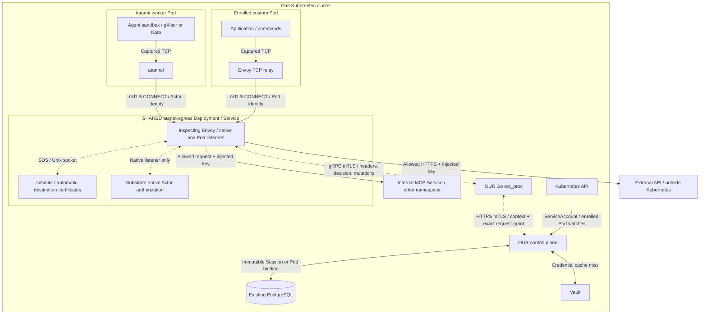

# Mastra session authorization demo

A session bridge binds an authenticated user and a selected Kubernetes ServiceAccount to a native kagent Session. An enrolled ordinary Pod is bound separately by its Kubernetes UID and actual ServiceAccount UID. A separate Go external processor evaluates policy code for HTTP(S) requests intercepted by one shared Envoy egress deployment. Credentials are injected by the gateway and never enter the agent environment.

The demo runs released kagent `1.0.0-alpha17` and Substrate `0.6.0-alpha3` with unchanged upstream source and binaries. Our components are the bridge, external processor, test APIs, and Mastra BYO image. Deployment configuration selects one shared Envoy gateway for native Actor and managed Pod traffic. The native authorization processor and SDS certificate minter are built from pinned, unchanged Substrate source.

Complete communication diagrams: [architecture and watch flow](docs/architecture.md). Editable Mermaid sources: [architecture](docs/architecture-current.mmd), [watches](docs/architecture-watch-cache.mmd).




## Run locally

Requires Linux x86_64, Docker, Minikube, kubectl, Helm, Go with automatic toolchain downloads, Node 22.22+, npm, OpenSSL, and Python packages from `requirements.txt`. The Docker driver profile uses 8 CPUs and 16 GiB RAM. Setup raises the host inotify instance limit to 8192 when needed to start another local Kubernetes node.

```bash
python3 scripts/up.py
python3 scripts/test_postgres.py
python3 scripts/test_e2e.py
python3 scripts/test_key_injection.py
python3 scripts/test_permissions.py
python3 scripts/test_shared_gateway.py
python3 scripts/benchmark.py
```

Every Kubernetes operation targets local Minikube profile `auth-demo` through `.cache/kubeconfig`; the user's default kubeconfig context is not used. Setup uses a loopback registry on port 5001 and a separate `demo` namespace. Setup also installs the opted-in command Pod and an external Docker HTTPS fixture. Both native Sessions and the Pod use the same `atenet-egress.ate-system.svc` Service: port 443 for Actor certificates and port 8443 for Pod certificates. A deterministic model drives the real Mastra agent loop and HTTP/command tool without a paid provider or provider credentials.

Development checks:

```bash
go test ./...
go test -race ./internal/...
go vet ./...
npm ci --prefix agent
node --test agent/server.test.mjs
```

The SQL tests in ordinary `go test` skip without `AUTH_DEMO_TEST_DATABASE_URL`. `scripts/test_postgres.py` runs them with the race detector in a temporary Pod against an isolated database on the existing local PostgreSQL server, then removes that database. Run integration tests and benchmarks sequentially to avoid competing load.

The upstream Helm chart still renders agentgateway. `scripts/deploy.py` replaces its egress deployment with the shared Envoy configuration; after a direct upstream Helm reinstall/upgrade, rerun it and then `scripts/permissions_demo.py` to restore the shared deployment and enroll the command Pod.

Generated certificates, passwords, kubeconfig, binaries, and logs stay in ignored `.cache/`. Demo certificates expire after seven days; regenerate `.cache/tls/` and redeploy when needed. Evidence is saved in `artifacts/` after successful test runs.

## Control plane and durable bindings

The bridge authenticates public callers through Kubernetes TokenReview with audience `auth-demo`. A SubjectAccessReview checks their `use` permission on the selected ServiceAccount. This permission is enforced by the bridge. It calls kagent under its own platform identity and enforces end-user Session ownership itself. Public caller authentication and account selection are not cached.

`POST /v1/sessions` accepts:

```json
{
  "agent": {"namespace": "demo", "name": "mastra-http"},
  "serviceAccount": "catalog-reader",
  "requestId": "reader-session-01"
}
```

The bridge reserves a launch intent, calls native CreateSession with a caller-scoped idempotency key, and persists Session ID and atespace → user, Agent, ServiceAccount namespace/name/UID. The binding is immutable. Mastra is invoked after registration; startup performs no application HTTP calls.

Persistence uses the **same PostgreSQL server and `kagent` database** as the platform. The bridge has a dedicated `auth_bridge_user` login and owns only its private `auth_bridge` schema. It does not query, join, migrate, or delete kagent's internal tables. The bridge role has no USAGE on the native `kagent` schema. TLS verifies the database hostname and projected platform trust bundle; password authentication uses SCRAM.

Our schema contains:

| Table | Purpose |
| --- | --- |
| `bindings` | Immutable identity mapping plus active/revoked state |
| `launches` | Caller-scoped request idempotency, original request and binding snapshot |
| `pod_bindings` | Immutable enrolled Pod UID/name → actual ServiceAccount namespace/name/UID |
| `metadata` | One-time legacy import marker |

Transactions and unique keys handle concurrent retries. A bridge Pod restart keeps mappings on the existing PostgreSQL persistent volume. The demo runs one bridge replica; multi-replica bridge operation and failover have not been benchmarked.

Existing bbolt data is imported once, read-only, by `cmd/import-bbolt`. Deployment stops the old bridge before import, preserves active/revoked state, and records a SQL marker to prevent later resurrection through reimport. The existing dataset imported 22 bindings and 22 launch records. The old `auth-bindings` PVC remains a backup and is not mounted by the running bridge. Fresh installations do not create this PVC. bbolt remains a dependency only for the migration tool.

`POST /v1/sessions/{id}/invoke` sends an A2A message through kagent. A Go BYO adapter built against the public release SDK supplies private A2A and TaskStore integration, invoking the TypeScript Mastra agent over loopback inside the same gVisor sandbox.

## Asynchronous Session cleanup

Deleting through the bridge revokes the binding before requesting native deletion. If kagent is still quiescing a request, the bridge returns HTTP 409 so the owner can retry; access stays revoked.

For deletion outside the bridge, its background job runs every five minutes:

1. Finish every page of native `ListSessions` under the bridge's platform identity.
2. Compare that set with active bindings, excluding mappings created within the last minute to avoid creation races.
3. Confirm each missing Session with native `GetSession`; only `NotFound` authorizes revocation.
4. After all listing and confirmation calls succeed, revoke confirmed deletions and purge retained rows whose retention period has elapsed.

Suspended and idle Sessions remain valid. Failed or partial scans, unexpected confirmation errors, and repeated pagination tokens abort cleanup. Revoked bindings are retained for 24 hours; retired launch records remain for seven days to prevent old request retries recreating a deleted Session during that period. Settings are `SESSION_GC_INTERVAL`, `BINDING_RETENTION`, and `REQUEST_ID_RETENTION`.

There is no native Session lookup on the HTTP authorization path. External deletion is therefore applied asynchronously after a successful cleanup run. `POST /internal/reconcile` exposes the same job to the authenticated internal client for tests and maintenance. No access lease or cache expiry is imposed.

## Policies and asynchronous watches

Eligible ServiceAccounts carry a managed label and policy annotations:

```yaml
metadata:
  labels:
    auth.demo.dev/managed: "true"
  annotations:
    auth.demo.dev/policy-type: catalog-access/v1
    auth.demo.dev/policy-config: >-
      {"agent":{"namespace":"demo","name":"mastra-http"},
       "origin":"https://catalog-api.demo.svc.cluster.local",
       "access":"read","credential":"read-token"}
```

Policies are ordinary Go code implementing `policy.Evaluator` and registered in `internal/policy/policy.go`. They receive trusted SessionContext and HTTP request data. Unknown types and evaluation errors deny access. `catalog-access/v1` permits `GET /catalog` for readers and additionally `POST /orders` for writers, requiring the configured Agent and exact HTTPS destination on port 443. `deny-all/v1` demonstrates policy revocation.

`permission-set/v1` attaches multiple complete grants to one ServiceAccount. A Session keeps one immutable ServiceAccount binding and can use every matching grant in its current policy. Grants are additive: at least one must match the entire destination, scheme, port, method and path. Fields from different grants cannot be combined. An empty set denies all requests; invalid entries and conflicting credentials in overlapping grants deny the request. A set supports up to 64 uniquely named grants. `http-request/v1` supports exact HTTP(S) origins on arbitrary ports and an optional Vault credential reference; legacy catalog grants can also be included.

For example, `multi-reader` authorizes three destinations independently:

```yaml
metadata:
  labels:
    auth.demo.dev/managed: "true"
  annotations:
    auth.demo.dev/policy-type: permission-set/v1
    auth.demo.dev/policy-config: >-
      {"permissions":[
        {"id":"catalog-read","type":"http-request/v1","config":{
          "origin":"https://catalog-api.demo.svc.cluster.local",
          "methods":["GET"],"paths":["/catalog"],"credential":"read-token"}},
        {"id":"internal-mcp","type":"http-request/v1","config":{
          "origin":"http://mock-mcp.test-services.svc.cluster.local:8080",
          "methods":["POST"],"paths":["/mcp"],"credential":"mcp-token"}},
        {"id":"external-read","type":"http-request/v1","config":{
          "origin":"https://external-api.auth-demo.test:8443",
          "methods":["GET"],"paths":["/external"],"credential":"external-token"}}
      ]}
```

Removing any grant takes effect through the existing ServiceAccount watch, without replacing the Session, Pod, or gateway. Gateway routes provide transport to configured destinations; policy grants determine each caller's access. Native HTTP routes retain Substrate Actor authentication and egress policy checks before our processor. Native platform/TaskStore hosts bypass our application processor while retaining native authorization. Native platform and TaskStore routes retain their existing behavior.

The control plane maintains informers for ServiceAccounts selected by `auth.demo.dev/managed=true` and Pods selected by `auth.demo.dev/egress=enforced` in `demo`. Policies contain credential references, never credential values. The bridge has no permission to read Kubernetes Secrets; application keys are stored in Vault KV v2.

There is **no scheduled policy polling, periodic informer resync, TTL expiry, or per-session preload**. Startup synchronizes account state; client-go reconnects and re-lists when watch recovery requires it. An uncached requested account triggers a coalesced authoritative GET. Unresolved misses deny access. Deleted or unmanaged accounts are rejected, and later add events clear their negative cache entries. GET results are not inserted into the watch store, so a delayed read cannot overwrite newer watch state.

Cached policy snapshots stay usable while a watch reconnects. Policy updates, managed-label removal, and account deletion/UID replacement become effective when their events arrive. This is intentionally eventual consistency, with no fixed revocation-time guarantee during an API outage. Recreating an account cannot inherit an old binding once its new UID reaches the cache.

For an allowed request, the processor resolves context, evaluates policy, then asks the bridge to approve the exact destination, method, path, policy version, and credential reference against its current snapshot. A version conflict triggers at most one context/evaluation retry before any request is forwarded, including for POST. Policies without credentials still require bridge approval. Credentials are returned only to the processor's authenticated client certificate.

Warm authorization uses in-memory policy and Vault credential caches plus PostgreSQL primary-key binding reads. It makes no Kubernetes object GET, Vault KV read, or native `GetSession` call. TokenReview/SAR are used for public bridge actions; informer startup/recovery and on-demand account misses also contact Kubernetes. Vault Kubernetes login uses TokenReview when a token is needed for a credential cache miss. The separate cleanup loop calls kagent, not Kubernetes object APIs.

## Vault credentials

The bridge reads credentials directly from Vault using the official Go SDK. With the demo settings, policy reference `read-token` resolves to `kv/data/auth-demo/demo/read-token`, field `token`. Path traversal, encoded separators, other Kubernetes namespaces, missing/empty fields, and newline-containing credentials are rejected. Only a policy-approved reference reaches the provider. The bridge Vault role can read exactly the reader, writer, MCP and external credential paths; it cannot write keys or read the mock services' private paths.

Vault authentication uses the bridge's projected ServiceAccount JWT with audience `vault`. Its short-lived Vault token stays in memory and is obtained again on demand before expiry or after an authentication failure. This creates no secret polling job. A deployment using Vault Agent can instead provide a token sink through `VAULT_TOKEN_FILE`; the agent then owns token renewal.

| Setting | Demo value / purpose |
| --- | --- |
| `VAULT_ADDR` | `https://auth-vault.demo.svc.cluster.local:8200`; HTTPS required |
| `VAULT_CACERT` | Trusted CA PEM file; TLS verification remains enabled |
| `VAULT_AUTH_MOUNT` | `kubernetes` |
| `VAULT_ROLE` | `auth-bridge` |
| `VAULT_JWT_PATH` | `/var/run/vault-identity/token` |
| `VAULT_KV_MOUNT` | `kv`; KV v2 required |
| `VAULT_KV_PREFIX` | `auth-demo`; Kubernetes namespace and credential reference are appended |
| `VAULT_KV_FIELD` | `token` |
| `VAULT_NAMESPACE` | Optional Vault Enterprise namespace |
| `VAULT_TOKEN_FILE` | Optional externally managed token sink, replacing Kubernetes login |

Successful reads are cached in control-plane memory, with at most 128 cached credentials. Concurrent misses share one Vault read. There is no TTL, scheduled refresh, or Kubernetes Secret copy. Existing cached keys remain usable during a Vault outage; unresolved misses fail closed. A cache entry is not automatically removed when Vault access is revoked or its value is deleted.

After rotating, deleting, or revoking a cached key, call `POST /internal/credentials/invalidate` over authenticated internal mTLS with `{"namespace":"demo","name":"read-token"}`. It evicts that entry; the next approved request reads Vault again, with no stale fallback if that read fails. Generation checks prevent an older in-flight read from restoring an invalidated entry. This invalidates one bridge process, matching the demo's single-replica deployment. The SDK does not implement Vault Enterprise event subscriptions or multi-replica invalidation.

Vault KV does not expose Kubernetes-style watches. [Vault instant updates require Enterprise event notifications](https://developer.hashicorp.com/vault/docs/deploy/kubernetes/vso/sources/vault/instant-updates); the local demo uses explicit invalidation to preserve the no-polling behavior. See the official [Kubernetes auth API](https://developer.hashicorp.com/vault/api-docs/auth/kubernetes) and [KV v2 API](https://developer.hashicorp.com/vault/api-docs/secret/kv/kv-v2) for matching server configuration.

Local setup runs Vault `1.21.4` with TLS and a dedicated persistent volume, and configures narrow Kubernetes-auth roles. Its root token and single demo unseal key stay in ignored `.cache/vault-admin.json` with mode 0600; neither is mounted in the bridge or sandbox. After a Vault Pod restart, rerun `python3 scripts/deploy.py` to unseal the local instance. Production Vault initialization, unsealing, and credential provisioning are managed externally. TLS certificates and the bridge PostgreSQL connection Secret remain deployment infrastructure; application reader/writer keys are exclusively in Vault. The old application-key Secrets and local plaintext seed file are removed after migration.

The mock catalog has a separate Vault role and private `mock/reader` and `mock/writer` paths. It loads those expected keys at startup, so changing the bridge's credential path independently can test a genuine upstream authentication failure.

## External processing and identity

`auth-ext-proc` has no mounted Kubernetes token, resource permissions, or database access. It receives the standard Envoy external processing gRPC protocol on port 50051, requiring the gateway's client certificate. It calls the bridge over HTTPS mTLS on port 8443. Unknown sessions, revoked bindings, and unavailable authorization dependencies cannot produce an allow.

The header phase contains HTTP headers plus `:method`, `:authority`, `:path`, and `:scheme`. The outer mTLS CONNECT listener writes the verified certificate URI SAN and actual CONNECT destination into `dev.ate.actor.identity` and `dev.ate.connect.authority` filter-state objects. These objects are carried into the private HTTP/TLS inspection listener. Application headers cannot set them.

Our processor receives those CEL filter-state attributes together with `xds.filter_chain_name`. It derives HTTP versus HTTPS from the trusted chain name and the destination port from the original CONNECT authority. A request's explicit authority port must agree. Native chains accept only native Session identities; managed Pod chains accept only Pod UID identities. The managed CONNECT leg validates the live registered Pod before allowing entry into inspection and releases no application credential.

The gateway uses hashable filter state to isolate internal upstream connections by caller and original destination. Envoy `1.38.6` supplies the required generic hashable-string factory. Replacing this with an ordinary string can mix connection metadata and is not supported. Two identities using one shared gateway never select each other's ServiceAccount from HTTP headers.

The sandbox sends placeholder Authorization. Our processor returns an overwrite mutation only after the bridge approves the exact request and rule-selected Vault reference. The mock reports credential acceptance without echoing tokens. The demo does not send bodies to our processor; query parameters and MCP tool names are not evaluated.

The shared gateway has two authenticated listeners, one Envoy proxy process, one Substrate native authorization helper and one `atenet sdsmint` helper. The minter uses the existing Substrate interception CA and delivers destination certificates through local SDS; both native sandboxes and enrolled Pods trust that public CA. Certificate RPCs and processor RPCs add no application forwarding proxy. Native Sessions and captured Pods both have two forwarding stages: their tunnel client, then this shared Envoy.

The pinned native Envoy bootstrap is adapted for inspected HTTP(S) using stock Envoy TLS/HTTP inspectors. Native Actor and per-request HTTP egress checks remain in the unchanged Substrate helper. Opaque TCP and TLS passthrough are not enabled in this demo. Platform and TaskStore traffic retains native authorization and bypasses our application permission checks.

## Specific command Pod and shared gateway

[command-runner.yaml](deploy/command-runner.yaml) is the actual deployed Pod template. The [rendered bundle](deploy/pod-egress-demo.yaml) includes the relay configuration, ServiceAccount policy and mock service. [shared-envoy.yaml](deploy/shared-envoy.yaml) contains the shared gateway resources. Private identity/TLS Secrets are provisioned separately by `scripts/permissions_demo.py`; the bundle contains no private keys or Vault credential values.

The command Pod runs real Mastra, whose tool executes `curl --noproxy '*'` through `execFile`. Transparent capture requires no proxy-aware application code or Istio:

1. A privileged init step with only `NET_ADMIN` and `NET_RAW` sets rules inside this Pod's network namespace.
2. Application TCP is redirected to the loopback Envoy relay on port 15001. The application is non-root, has no capabilities, and cannot become the relay UID.
3. Envoy reads the original destination and sends mTLS CONNECT to the managed-Pod listener on `atenet-egress.ate-system.svc:8443`. Only the relay UID can reach that Service IP/port. DNS is allowed only to the cluster resolver; other UDP and non-loopback IPv6 are blocked in this IPv4 fixture.
4. The shared Envoy terminates CONNECT, uses SDS to intercept HTTPS under the trusted Substrate CA, and sends HTTP headers plus the verified Pod SPIFFE identity to our ext_proc service.
5. The bridge resolves the durable Pod UID binding, checks watched Pod and ServiceAccount UIDs, and evaluates the current permission set. The gateway forwards permitted requests with the rule-selected key from Vault.

These rules affect only the explicitly installed Pod template. The local Minikube CNI does not enforce NetworkPolicy; this implementation enforces capture and its egress exceptions in the Pod itself. A gateway-only ingress allowance admits enrolled Pods to the managed listener on policy-enforcing CNIs; it does not change MCP ingress. No mock-service ingress restrictions, cluster-wide defaults, or changes to unrelated workloads are introduced. The test confirms that an unrelated Pod can still reach the mock directly. Both caller types converge on one shared gateway; unrelated workloads keep their existing paths.

The trusted demo launcher observes the created Pod UID, issues the relay's client certificate with URI SAN `spiffe://auth-demo.local/ns/demo/pod/<uid>`, and calls `POST /internal/pods` using internal mTLS. That endpoint reads the actual Pod's ServiceAccount rather than trusting a requested account name. Relay keys are not mounted in the application container. Deletion, loss of enrollment label, Pod UID replacement, or ServiceAccount UID replacement denies the old identity once its watch event arrives. Bindings survive bridge restarts in PostgreSQL. Pod mapping rows currently remain for troubleshooting; native Session retention jobs do not purge them.

Container restart within the same Pod preserves its UID and certificate. A replacement Pod needs enrollment and a new certificate; rerun `python3 scripts/permissions_demo.py` for this demo. Automatic certificate issuance/rotation for arbitrary Deployment replacements is outside this launcher. Recreating a gateway or DNS Service with a different ClusterIP also requires rerunning the launcher to update the Pod's fixed firewall destinations.

The other namespace hosts an HTTP authentication mock at `/mcp`, rather than an MCP protocol implementation. The external HTTPS authentication mock runs in a Docker container outside Kubernetes, with no Service or Endpoint representing it. Setup adds one exact test DNS record in CoreDNS and preserves other DNS configuration. Its distinct expected synthetic keys are read from Vault into a mode-0600, ignored fixture file mounted read-only outside Kubernetes. Application credential selection in the bridge always uses Vault. These tests establish destination/method/path filtering and key insertion, including Mastra command execution. Adding MCP JSON-RPC tool-name or body filtering requires an evaluator and body processing configuration.

## Validation and benchmark

Run `python3 scripts/test_shared_gateway.py` to exercise both caller types through the same live Envoy Pod. The [shared-gateway report](artifacts/shared-gateway-results.json) records the gateway UID, caller UIDs, images, actual upstream audit deltas, and the external fixture's Docker network address.

| Caller | Target | With matching grant | Without grant |
| --- | --- | --- | --- |
| Native kagent Session | Internal MCP in `test-services` | 200, MCP key accepted | 403, zero upstream calls |
| Captured Pod / real Mastra curl command | Internal MCP in `test-services` | 200, MCP key accepted | 403, zero upstream calls |
| Native kagent Session | HTTPS service outside Kubernetes | 200, external key accepted | 403, zero upstream calls |
| Captured Pod / real Mastra curl command | HTTPS service outside Kubernetes | 200, external key accepted | 403, zero upstream calls |

The 59-check suite tests all eight subsets of catalog/MCP/external grants from both callers, giving 48 matrix cases. It also checks forged identity and Authorization headers, cross-listener certificate rejection, automatic SDS issuance, zero warm Kubernetes object GETs/Vault reads, and concurrent native Sessions with different ServiceAccounts alongside the Pod. A credential-free `https://example.com/` request from each caller tests public Internet HTTPS in addition to the controlled external authentication mock.

Run `python3 scripts/test_permissions.py` for the new [27-check Minikube suite](artifacts/permissions-results.json). It keeps one native Session ID and one Pod UID while changing only their shared ServiceAccount's permission set:

| Current grants | `GET` HTTPS catalog | `POST` internal HTTP mock |
| --- | --- | --- |
| None | 403 | 403 |
| Catalog only | 200 | 403 |
| Catalog + MCP | 200 | 200 |
| MCP only | 403 | 200 |

Every row is tested through both native Mastra HTTP and the captured Pod's real curl command, with upstream audit counts and exact credential acceptance. Further checks cover mixed-rule attacks, forged identity/Authorization headers, Service/Pod IP bypass attempts, unchanged direct access from an unrelated Pod, non-DNS UDP rejection, watched Pod enrollment removal, gateway outage and recovery, and zero object/Vault reads across eight warm Pod requests. Gateway recovery is probed using safe GETs before attempting a new POST; the test never retries a side-effecting request automatically.

The [post-restart checks](artifacts/shared-recovery-results.json) confirm that the same Pod UID binding survives bridge replacement and all four internal/external paths work after gateway and control-plane restarts.

For a focused credential-insertion test, run `python3 scripts/test_key_injection.py` against the deployed demo. It uses the HTTPS catalog mock with two synthetic opaque bearer keys stored in Vault; no external provider account or production key is needed. The mock compares exact key values and rejects missing, incorrect, empty, or duplicate Authorization credentials. Responses and its audit show only the matched identity and header count.

The [key-injection results](artifacts/key-injection-results.json) exercise real native Mastra Sessions through the gateway: placeholder replacement, overwriting a forged Authorization header, reader/writer key selection, and blocked reader writes. Changing the bridge's Vault key and invalidating its cache produces an actual upstream HTTP 401; restoring it and invalidating again restores HTTP 200 without restarting the bridge or processor. The test also verifies that the bridge's real Vault role cannot read mock-private keys or write application keys. It restores the key and removes its Sessions, records no key values, and checks that keys are absent from responses, mock audit, and Harness configuration. This validates the bearer-header mechanism against a local mock; it does not exercise a provider's live API.

The [Minikube integration results](artifacts/e2e-results.json) cover 20 checks using real reader and writer native Sessions: authentication, account selection, ownership, immutable binding, allowed/denied Mastra tools, forged identity, encoded paths, policy and managed-label changes, processor outage, Vault credential refresh, zero warm object/Vault reads, durable bridge restart, ServiceAccount UID replacement, and asynchronous cleanup after native deletion. Test API audit counts distinguish gateway denial from upstream rejection.

[PostgreSQL integration results](artifacts/postgres-tests.json) cover 32 concurrent Session retries and Pod registrations, immutable bindings, persistence across independent pools, shared revocation, retention/tombstones, and one-time import preserving revoked/purged state. Go race tests also cover Pod UID/ServiceAccount UID replacement and deletion, expired-watch relist recovery, disconnected snapshot use, partial-scan cleanup safety, suspended Sessions, bounded policy-version retries, Vault cache coalescing, safe invalidation during in-flight reads, and error redaction.

`scripts/benchmark.py` runs bounded closed-loop load in a temporary Pod, captures deployment images, configuration, resource samples, and before/after authority counters, then removes its temporary Sessions and credentials. Full-path stages execute real Mastra HTTP tools inside two native Sessions; request latency includes sandbox networking, gateway, processor, bridge, PostgreSQL, and catalog API. A2A setup/response time is reported separately. Direct processor stages exclude gateway/upstream and assert a real Session SPIFFE ID using the gateway client certificate; they do not measure gateway identity verification.

The shared PostgreSQL server keeps `max_connections=100`. Connection budgets are bridge 4, kagent 8, and Substrate API 8 per replica. Native components retain additional dedicated pools. These supported configuration settings avoid CPU-derived defaults exhausting the shared server. No upstream source patch or PostgreSQL server limit increase was needed.

<!-- benchmark-results:start -->
The historical agentgateway [Vault-backed run](artifacts/benchmark-results.json), started at `2026-10-24T14:31:06Z`, completed in 121.0 seconds:

| Concurrent reader GETs | Successful / attempted | Successful requests/sec, before Vault → Vault | p95 latency, before Vault → Vault |
| --- | --- | --- | --- |
| 1 | 3,438 / 3,438 | 165.79 → 171.87 | 7.28 → 6.96 ms |
| 4 | 1,279 / 1,279 | 215.03 → 212.83 | 68.29 → 69.23 ms |
| 16 | 1,608 / 1,608 | 246.84 → 265.76 | 116.73 → 111.41 ms |
| 64 | 1,444 / 1,444 | 238.78 → 231.89 | 689.17 → 700.93 ms |

The previous column is the same PostgreSQL bridge with Kubernetes Secret watches. These are separate bounded local runs; differences do not establish a Vault performance advantage. The writer POST stage completed 1,341/1,341 requests at 223.16 requests/sec; all 1,646 forbidden reader POSTs were blocked before upstream. Direct mixed ext_proc traffic at concurrency 128 completed 2,020 requests at 382.76 requests/sec with p95 593.69 ms.

Across all stages: **zero authorization bypasses, wrong credentials, failed allowed HTTP requests, direct unexpected denials, or direct transport errors**. All upstream audit counts matched successful requests. Three recovery reads succeeded in 14.05 seconds. Warm traffic recorded **zero ServiceAccount GETs, zero Vault reads/logins, zero LIST calls, and zero native Session GETs**. Nine bridge TokenReviews were for public actions rather than individual HTTP requests. The measured interval contained 39,479 context requests and 15,640 grant requests.

Five-second samples observed peaks of approximately 0.86 CPU cores / 17.6 MiB working set for the processor and 0.80 CPU cores / 19.7 MiB for the bridge. These are sampled values, not instantaneous maxima.
<!-- benchmark-results:end -->

Historical evidence is retained: [before Vault](artifacts/benchmark-results-before-vault.json), [uncached](artifacts/benchmark-results-uncached.json), [cache only](artifacts/benchmark-results-cache-only.json), [bbolt + TTL + batching](artifacts/benchmark-results-before-reimplementation.json), and [first watch/PostgreSQL run before connection budgeting](artifacts/benchmark-results-watch-pg-before-pool-budget.json). The latter had 59 failed allowed requests caused by PostgreSQL connection exhaustion. Earlier comparisons include storage, watch strategy, removal of hot-path native Session reads, and pool-budget configuration changes.

The benchmark above predates the shared Envoy deployment. It is a single-node local benchmark with one bridge and one processor replica, bounded stage durations, and closed-loop concurrency. It establishes the MVP's behavior and measured limits; it is not an overnight soak or a production capacity guarantee.
