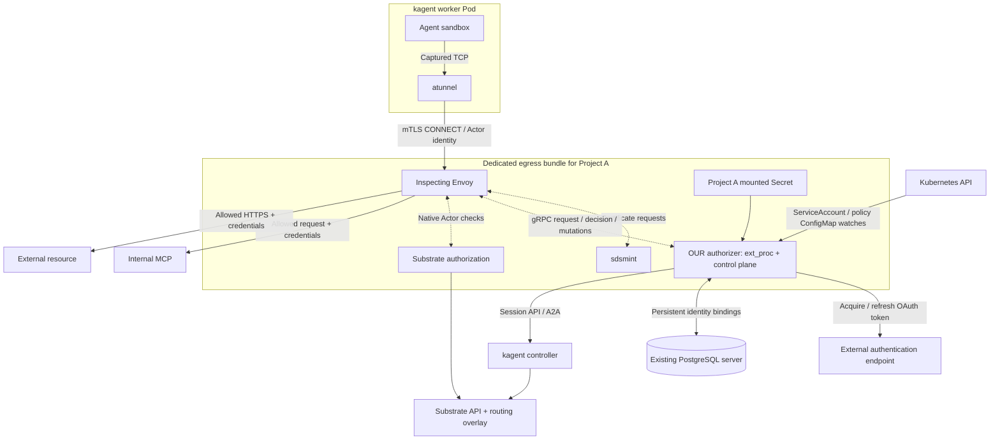

# Project agent authorization

A Mastra agent runs in a native kagent/Substrate sandbox. Each GitLab project has its own Envoy egress bundle and a single Go authorizer containing both the Session bridge/control plane and Envoy `ext_proc`. Application credentials are mounted only into that authorizer, never into the sandbox or Envoy. Multiple Agents in the project namespace share its WorkerPool and proxy.

Deployment files and apply order: [three Kubernetes bundles](k8s/README.md).

The demo pins kagent `1.0.0-alpha17` and Substrate `0.6.0-alpha3`. kagent, workers, atunnel, native authorization and sdsmint retain their existing behavior. A small [Substrate API routing overlay](upstream/substrate.patch) selects the gateway by Actor namespace and registers the exact gateway SPIFFE identities. **One GitLab project uses one namespace.** Agents in that namespace reuse one WorkerPool and dedicated project gateway.



Project B gets its own egress bundle, application Secret, policy and database login. Agents inside Project A share its bundle while retaining their own Session identities and permissions. Platform trust material is shared; application credentials and token caches are scoped to each project authorizer. Other cluster workloads keep their current network behavior. The old shared proxy and enrolled custom Pod implementation have been removed; Git history retains them.

## Identity and permissions

`POST /v1/sessions` authenticates the caller using Kubernetes TokenReview, then checks their `use` permission on the selected ServiceAccount with SubjectAccessReview:

```json
{"agent":{"namespace":"auth-agent-a","name":"mastra-http"},"serviceAccount":"agent-caller","requestId":"launch-01"}
```

The bridge creates a native kagent Session and persists an immutable Session → Agent → user → ServiceAccount UID binding in PostgreSQL. Request retries preserve the binding. HTTP headers from the sandbox cannot choose identity: the native gateway obtains Actor identity from the authenticated CONNECT certificate and sends trusted filter state to `ext_proc`.

The managed ServiceAccount references a namespaced policy ConfigMap:

```yaml
apiVersion: v1
kind: ServiceAccount
metadata:
  name: agent-caller
  namespace: auth-agent-a
  labels:
    auth.demo.dev/managed: "true"
  annotations:
    auth.demo.dev/policy-ref: agent-permissions
automountServiceAccountToken: false
---
apiVersion: v1
kind: ConfigMap
metadata:
  name: agent-permissions
  namespace: auth-agent-a
  labels:
    auth.demo.dev/managed: "true"
data:
  type: permission-set/v1
  config: >-
    {"permissions":[{"id":"mcp-read","type":"http-request/v1","config":{
      "origin":"http://internal-mcp.test-services.svc.cluster.local:8080",
      "methods":["GET"],"paths":["/catalog"],"credential":"api-token"}}]}
```

Policies are registered Go filtering logic in [internal/policy](internal/policy). `permission-set/v1` supports up to 64 additive grants. Each grant matches a complete origin, method and path; overlapping grants with conflicting credentials deny. Unknown or malformed policies fail closed. Native kagent `EgressPolicy` still supplies the coarse transport destinations; our ConfigMap policy adds request-level permissions and credential references. It is evaluated in Go, rather than translated into Envoy routes. The current processor runs at the HTTP request-header phase; body and response filtering require another processing mode.

ServiceAccounts and policy ConfigMaps use asynchronous label-filtered watches with zero periodic resync. An uncached requested object may cause a coalesced authoritative GET; updates are eventually consistent. Credential rotation uses the projected Secret file, with no Secret API watch or polling. Warm authorization makes PostgreSQL binding reads and local file/cache accesses, with no Kubernetes object GET or Vault call.

## Credentials and persistence

GitLab resolves project-specific Vault secrets and applies a Kubernetes Secret with one `credentials.json` file. The authorizer has no Kubernetes Secret-read permission. The Secret is mounted as a directory, so Kubernetes can replace its projection atomically; do not use `subPath` for the credential file.

Supported entries:

```json
{
  "api-token":{"type":"bearer","token":"<secret>"},
  "oauth-api":{"type":"oauth2","tokenEndpoint":"https://login.example/token",
    "clientId":"<client-id>","clientSecret":"<client-secret>","scopes":["catalog.read"]}
}
```

OAuth uses the client-credentials grant, verifies HTTPS, rejects redirects, coalesces simultaneous refreshes, and caches tokens until shortly before expiry. A mounted document change clears that authorizer's token cache. Rotation during an exchange prevents publishing the previous token. Credential values and authorization headers are excluded from logs. Other login protocols require another resolver.

The local pilot reuses the platform PostgreSQL server, with a separate login/database and private `auth_bridge` schema per project. It never queries kagent's internal tables. Bindings survive bundle restarts. Revocation occurs before bridge-driven native deletion. A background job lists native Sessions every five minutes and confirms missing Sessions before revoking; suspended Sessions remain active. Revoked bindings stay 24 hours for debugging and retired request IDs seven days. Failed or partial scans do not clean up mappings.

## Run and test

Requires the pinned kagent/Substrate platform and Kubernetes PodCertificate/ClusterTrustBundle features, Docker, Minikube, Go, Node/npm, OpenSSL and `pip install -r requirements.txt`. All cluster commands explicitly use `.cache/kubeconfig` and context `auth-demo`.

```bash
# Existing local platform:
python3 scripts/build.py
python3 scripts/deploy.py
python3 scripts/test_e2e.py
python3 scripts/test_project.py
python3 scripts/benchmark.py
python3 scripts/test_postgres.py

# Fresh local platform, then build/deploy:
python3 scripts/up.py
```

kagent may reject simultaneous A2A messages to one Session with a resource conflict. The load test sends one invocation and generates concurrent HTTP requests inside the sandbox.

The first project runs two Agents on one WorkerPool and proxy; [the project sharing test](artifacts/project-sharing.json) verifies their identities and isolation from the other project. Run it with `python3 scripts/test_project.py`.

The two test namespaces are `auth-agent-a` and `auth-agent-b`. The test uses real kagent Sessions and the Mastra tool loop, an HTTP MCP mock in another namespace, and an HTTPS Docker mock outside Kubernetes. Generated keys, certificates, kubeconfig and binaries stay in ignored `.cache/`. Test reports are saved under `artifacts/dedicated-*`; earlier reports describe the removed architecture and are historical only.

```bash
go test ./...
go test -race ./internal/...
go vet ./...
python3 scripts/test_deploy_bundle.py
node --test agent/server.test.mjs
python3 k8s/test_render.py
```

The SQL tests skip without their integration environment; `test_postgres.py` runs them against an isolated database. The full local installer is separate from testing changes on an existing cluster. Minikube does not establish production CNI enforcement, multi-node behavior, HA or a performance SLA. Approval UI integration and non-HTTP protocol adapters remain future work.

## Validated on local Minikube

The [dedicated E2E report](artifacts/dedicated-e2e.json) contains 13 passing checks: real Sessions, internal/external credential injection, operation denials, cross-project and mTLS isolation, multiple grants, ConfigMap updates, Secret rotation, warm cache behavior, bundle restart persistence and ServiceAccount UID revocation. [PostgreSQL tests](artifacts/dedicated-postgres-tests.json) also passed with the race detector.

Bounded HTTP load from one Mastra invocation, five seconds per case:

| Concurrency | Requests/s | p95 ms | HTTP / credential errors |
| --- | --- | --- | --- |
| 1 | 298 | 3.9 | 0 |
| 8 | 738 | 52.3 | 0 |
| 32 | 597 | 116.0 | 0 |

These local measurements include proxy authorization and the internal mock HTTP request. They exclude A2A invocation startup and establish neither production capacity nor a comparison against historical benchmarks. The remaining cluster fixtures and CPU limits affect results.

See the [DevOps production task](docs/devops-production-task.md) and the [GitLab example](k8s/namespace/gitlab-ci.example.yml).
