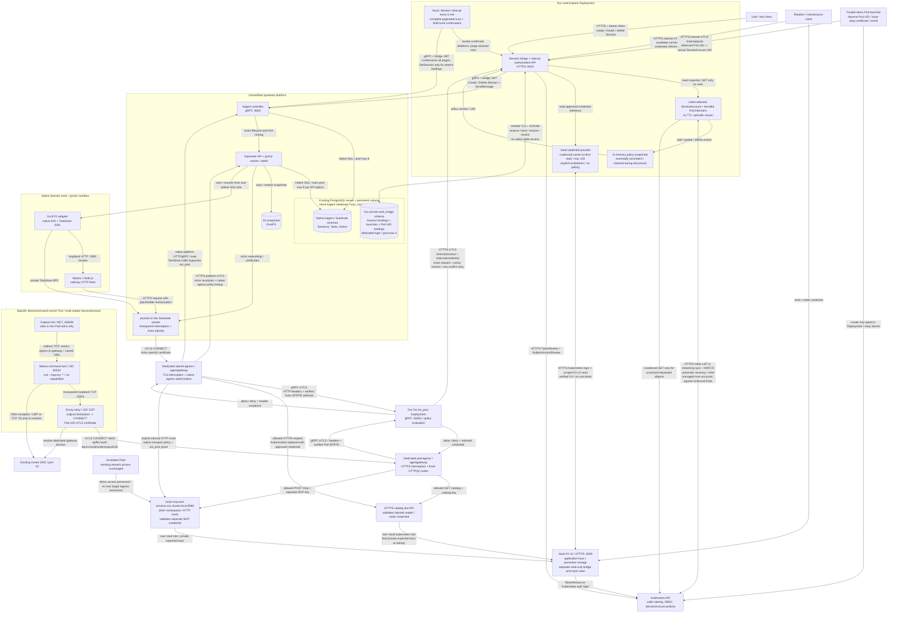
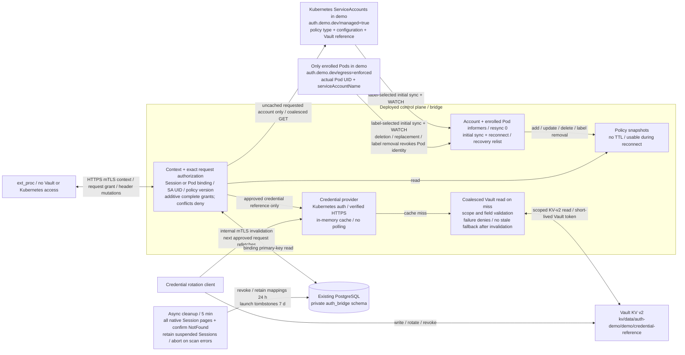

# Deployed communication diagrams

The native kagent Session and the specific command Pod use dedicated gateways and the same processor/control plane. PostgreSQL persists both identity mappings. ServiceAccount watches update permission sets; enrolled Pod watches validate Pod identity. Vault supplies rule-selected credentials.

Only the opted-in command Pod receives the capture/firewall template. Other Pods keep their existing routes; the cross-namespace mock service has no new ingress restrictions.

## Complete architecture

## Policy and Vault credential flow

One Session binds to one ServiceAccount UID. That account can hold multiple complete grants: for example `GET /catalog` on the HTTPS catalog and `POST /mcp` on the HTTP mock in `test-services`. The processor grants a request if a complete permission matches; it never combines destination, method or credentials across separate grants. Removing a grant takes effect after its watch update arrives, without recreating the Session or Pod.

The command Pod redirects its TCP connections to Envoy in its own network namespace. Envoy authenticates to `pod-egress` using a Pod UID certificate; application containers cannot read that key. The Pod firewall allows only this gateway connection and cluster DNS outside loopback. It does not depend on CNI NetworkPolicy support.

The demo launcher handles certificate issuance and Pod enrollment. A replacement Pod requires re-enrollment; the old certificate cannot inherit its identity. The mock's `/mcp` endpoint tests HTTP authorization and key insertion, not MCP JSON-RPC tool-name filtering.
