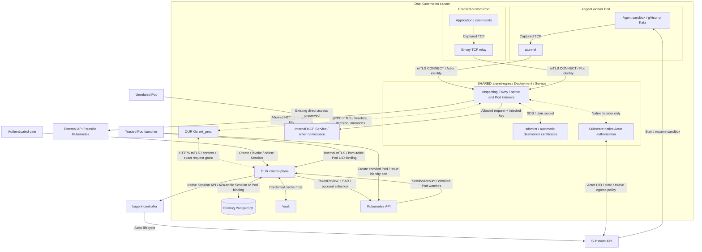
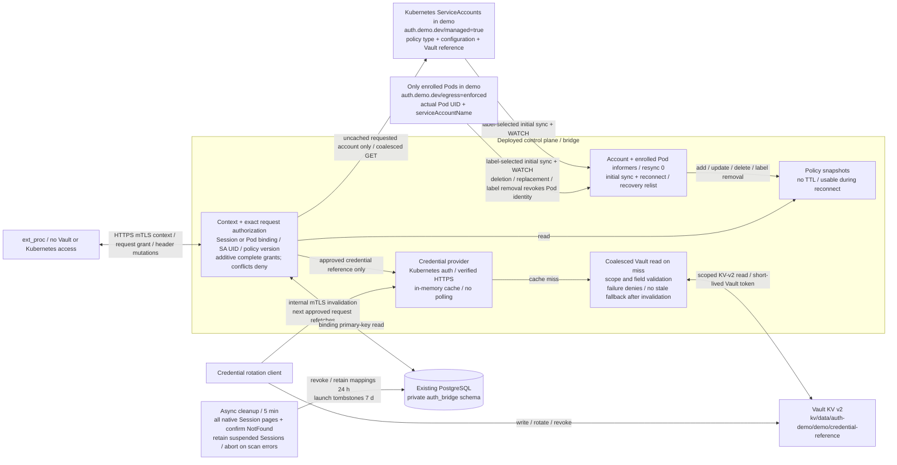

# Shared Envoy egress architecture

Native kagent sandboxes and enrolled custom Pods use one `atenet-egress` Deployment and Service. The native Actor listener is on Service port 443; the managed Pod listener is on 8443. Both call our external processor. Each source has two forwarding stages: its tunnel client and the shared Envoy.

The native listener uses the existing Substrate Actor certificate checks and per-request egress policy helper. The Pod listener validates our Pod UID certificates through the durable ServiceAccount binding. The two certificate trust domains are separate; HTTP headers cannot choose a caller class or ServiceAccount.

`sdsmint` serves destination certificates through a local Unix socket. Our processor and the certificate issuer receive RPCs; application traffic is forwarded by Envoy. Hashable filter state keeps each identity and original destination isolated across internal connections. The gateway uses Envoy 1.38.6.

Internal services retain their existing ingress configuration. The external authentication fixture is a Docker HTTPS service outside Kubernetes, without a Kubernetes Service or Endpoint. Only enrolled Pod network namespaces receive capture/firewall rules. A narrow gateway ingress allowance admits these Pods to the managed listener where NetworkPolicy is enforced.

## Policy and credential flow

ServiceAccount policy changes arrive through watches. Each complete grant independently matches origin, port, method and path; multiple grants can belong to the same Session or Pod identity. Vault credentials are cached on first read and explicitly invalidated. PostgreSQL persists immutable bindings across control-plane restarts.
