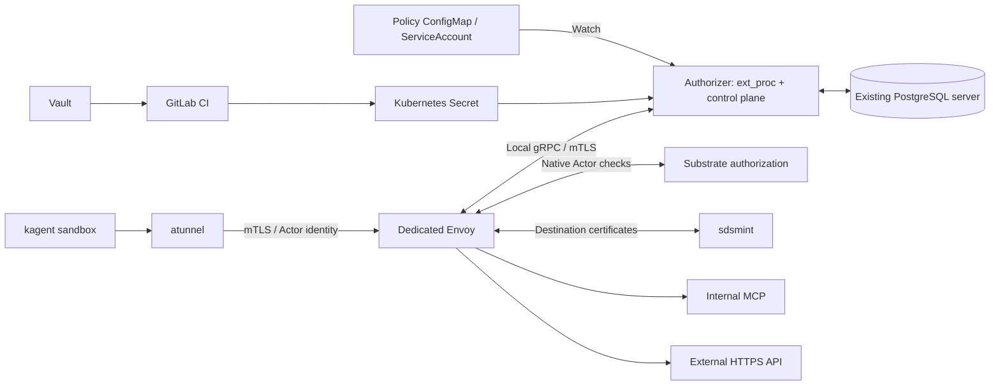

# Deploy dedicated agent authorization to production

**Owner:** DevOps / platform team. **Dependencies:** application team release and production readiness work below.

Deploy the tested kagent egress scheme through GitLab: one namespace and one dedicated egress bundle per deployed Agent. Deliver a reusable deployment package, validate it in staging, then promote the same image digests and chart version to production. This task prepares deployment; it does not authorize changes to a production cluster from the local demo scripts.

## Target architecture and scope

Envoy, the native authorization helper and our combined authorizer share one Pod; sdsmint is a native sidecar in that Pod. Each Agent gets its own bundle, application Secret, local mTLS trust boundary and database login. Only the custom authorizer mounts application credentials. Internal MCP and external HTTP(S) use the same filtering path.

Keep kagent, worker binaries and atunnel unchanged. Build Substrate API with the tracked [routing overlay](../upstream/substrate.patch), which selects a gateway by Actor namespace and registers exact gateway SPIFFE principals. The current selector supports **one deployed Agent per namespace**. An individual Session may have multiple permission grants through its bound ServiceAccount policy.

Changes apply to enrolled agent namespaces. Preserve other workloads and the platform default gateway. No cluster-wide traffic restrictions, MCP ingress restrictions, service mesh, custom Pod branch, approval UI or PostgreSQL protocol adapter are included. The current custom processor filters HTTP request headers, destinations, methods and paths.

## Inputs and application release dependencies

Fill these deployment inputs before rendering the release:

| Input | Required value |
| --- | --- |
| Environments | Staging and production contexts, cluster DNS suffix, platform namespaces and endpoints |
| Agent identity | Namespace, exact Agent name, permitted callers and selectable ServiceAccounts |
| Runtime/storage | Supported SandboxConfig, worker capacity, registry access and native snapshot object-store endpoint/prefix |
| Artifact references | Reviewed Git commit, chart version and registry image digests |
| Credentials | Project Vault JWT role, audience, permitted KV paths and CI deployment identity |
| Database | Existing PostgreSQL endpoint, per-agent database/login, CA, backup and restore ownership |
| Certificates | Signers, trust bundles, per-bundle client/server issuers, rotation ownership |
| Capacity | Agent/session count, expected concurrent HTTP requests, latency/error targets, availability and recovery targets |

The tested versions are kagent `1.0.0-alpha17`, Substrate `0.6.0-alpha3` and Envoy `1.38.6`. The platform owner must approve the exact production versions. Any upgrade requires rebuilding and retesting the overlay and gateway configuration; do not substitute a newer release without validation.

Application team dependencies:

- Review and tag the refactor, then publish immutable images tied to the release commit. Deploy by recorded digests.
- Replace the Minikube-specific installer with a portable release interface. The [bundle renderer](../scripts/dedicated_gateway.py) and [local deployment script](../scripts/deploy.py) are implementation references. Registry addresses, namespace names, platform DNS, trust roots and images need release values; local Docker/Minikube and PostgreSQL Pod-exec provisioning are excluded from production delivery.
- Provide health checks that verify the authorizer's processing service and database usability. Its current `/readyz` returns a static success after startup; Envoy readiness alone does not prove authorization works.
- Confirm the caller authentication contract. The current bridge uses Kubernetes TokenReview with hardcoded audience `auth-demo`, then SubjectAccessReview for `use` on the selected ServiceAccount. Configure this audience in code if production requires another value. Corporate OIDC login is not implemented by this endpoint.
- Confirm the target environment permits the current plaintext gRPC hop to kagent. Client TLS support requires application work if that hop must use TLS.
- Deliver operational authorization latency/error/denial metrics. Current authorizer counters are JSON at mTLS-protected `/internal/stats`; they are not a Prometheus endpoint.
- Validate the replica and rollout model against the availability target. The tested bundle has one replica and `Recreate`; it causes an interruption on replacement. Multiple replicas, draining and failover need validation before claiming continuous availability. A PDB alone does not provide redundancy.

## DevOps deliverables

**1. Package the platform integration and agent release separately.** Use Helm and the team's existing GitOps/deployment workflow. Publish reproducible images for the custom authorizer and patched Substrate API; publish the pinned Substrate `atenet` binary used for native authorization and sdsmint. Parameterize the production agent image independently of the Mastra test fixture. Keep the routing overlay auditable and versioned with its upstream base.

Verify target Kubernetes support for PodCertificate projection/signing, ClusterTrustBundle projection, native sidecars, and the pinned kagent/Substrate CRDs. Preserve upstream worker capture and native authorization. The local runtime was gVisor; validate capture and suspend/resume on the selected production runtime. Configure the Harness snapshot location and access to the platform object store so native suspension/restoration works. Keep snapshot prefixes scoped to the deployed Agent. The local rebuilt API retained the upstream runtime UID needed to access its object-store sidecar socket; verify socket ownership when applying the production security context.

**2. Provision the following resources.** Cluster-scoped bindings and platform configuration belong to the platform pipeline; project pipelines deploy their permitted namespace resources.

| Scope | Resources and purpose |
| --- | --- |
| Platform | Patched Substrate API image; protected cumulative namespace → gateway ConfigMap; exact gateway principals; existing signers and trust infrastructure |
| Per Agent | Namespace; `agent-egress` ServiceAccount; Role/RoleBinding to get/list/watch ServiceAccounts and ConfigMaps |
| Caller selection | Managed identity ServiceAccounts with policy references; `use` Role/RoleBinding for explicitly permitted callers |
| Reviewer access | TokenReview and SubjectAccessReview ClusterRole plus binding to the authorizer's ServiceAccount |
| Egress | Dedicated Deployment, Envoy/SDS ConfigMaps, upstream trust, gateway and authorizer ClusterIP Services |
| Credentials | Referenced application Secret, database Secret, per-bundle mTLS Secrets and platform certificate material |
| Policies/runtime | Managed policy ConfigMaps; native `EgressPolicy`, `WorkerPool`, `Harness` and `Agent` |

ServiceAccounts carry `auth.demo.dev/managed=true` and an `auth.demo.dev/policy-ref` pointing to a managed ConfigMap in the same namespace. The ConfigMap contains the evaluator `type` and JSON `config`; see the [policy example](../README.md#identity-and-permissions). Native `EgressPolicy` grants coarse transport origins; the ConfigMap supplies request permissions and credential references, without secret values. Application teams own policy logic and grants.

Use the existing `ate.dev/api-access=true` namespace integration where the upstream NetworkPolicy requires it. The native policy excludes worker Pods from that direct API allowance. Validate this behavior with the production CNI; do not broaden API access to workers to resolve a connectivity problem. Restrict updates to routing assignments to the platform owner and preserve assignments for other Agents.

**3. Wire connectivity and authentication.** Render the actual platform endpoints and DNS suffix, including exact short and fully qualified platform hostnames. Native Session and TaskStore requests must retain their existing native checks while bypassing our application policy filter.

| Link | Current port / behavior |
| --- | --- |
| Worker atunnel → gateway Service | TCP 443 → Envoy 8443, native Actor mTLS identity |
| Envoy → our authorizer | Local gRPC 50052, TLS 1.3 with client authentication, fail closed |
| Envoy → native processor | Local gRPC 50051 |
| Envoy → sdsmint | Shared Unix socket |
| Caller → authorizer Service | HTTPS 8443 → 8444; public Session API uses bearer authentication |
| Authorizer → Kubernetes / kagent / PostgreSQL | Target API endpoint / gRPC 8083 / verified PostgreSQL TLS, normally 5432 |
| Envoy → destinations | Explicit internal/external origin ports allowed by transport and request policies |

Keep the processor and Envoy administrative interfaces private. If Session management needs an external entrypoint, expose only `/v1/sessions` and its supported subpaths through the existing authenticated access tier. Keep `/internal/*` restricted to operations with client certificates; preserve bearer headers needed by TokenReview. Ingress TLS and timeouts must account for the authorizer's HTTPS upstream and A2A invocation duration.

Preserve the tested local mTLS identities: gateway client CN `auth-egress`, authorizer server SAN `authorizer`, and operations client CN `ext-proc`. Use separate client trust roots per bundle. Application credential rotation uses the projected file; local mTLS and database settings are loaded at process startup and require a controlled replacement on rotation. Preserve the upstream certificate renewal/SDS mechanisms separately.

**4. Implement GitLab → Vault → Secret delivery.** Use the [GitLab example](../deploy/gitlab-ci.example.yml) as a starting point. Configure project-scoped Vault OIDC/JWT access and deploy only secrets authorized for that project. The chart references existing Secrets; credential values must not enter chart values, repository files, CI logs or retained artifacts.

Mount one `credentials.json` document as a directory projection only into the custom authorizer, without `subPath`. The existing resolvers support static bearer credentials and OAuth client credentials. References in policies select entries in that document. Runtime authorizers require no direct Vault connection or Kubernetes Secret-read API rights. A Vault change reaches runtime only after the CI delivery step updates the Kubernetes Secret; Secret projection then updates eventually, without a polling job.

**5. Provision persistence and operations.** Reuse the existing PostgreSQL server with a separate database/login per agent deployment and its private `auth_bridge` schema. Precreate that schema with the appropriate owner: the application creates/migrates its own tables at startup. Use verified TLS and a dedicated connection budget: the current pool limit is four connections per authorizer replica. Grant no access to kagent's internal tables. Include authorization databases in backup/restore procedures and test restoration of immutable bindings.

Keep current configurable lifecycle defaults unless the product owner changes them: cleanup every five minutes, revoked bindings for 24 hours, retired request IDs for seven days. Suspended Sessions remain valid. Policy changes use asynchronous ServiceAccount/ConfigMap watches, with coalesced GETs for requested cache misses. Preserve eventual update behavior; introduce no scheduled Kubernetes polling or per-request native Session lookup.

Collect Envoy request metrics, authorization errors/denials, watch reconnect failures, OAuth refresh failures, database saturation, cleanup failures and certificate expiry. Distinguish expected policy denials from service failures. Retain Session/Agent/ServiceAccount identifiers and reasons for troubleshooting, excluding credentials and bearer headers. Provide runbooks for credential/policy changes, certificate replacement, database recovery, stuck Sessions and gateway outage.

## Rollout and acceptance

Deploy first to staging with the production Kubernetes/CNI and identity integrations:

1. Publish the release artifacts and provision the namespace, database, credentials and trust material.
2. Deploy the dedicated bundle and worker resources; verify certificate issuance and dependencies.
3. Add the namespace to the protected gateway map and roll out **all** Substrate API replicas. The map loads at process startup. Enable the Agent and Session entrypoint only after every replica has the same assignments.
4. For an existing running Agent, quiesce invocations and move existing sandboxes through a validated suspend/resume or replacement procedure. Updating the map does not reroute already running atunnels. Keep durable Session bindings where the same Session is resumed.
5. Run the acceptance checks below, promote the same release to one production Agent, then expand using the agreed deployment process.

Acceptance evidence must cover:

- Two Agents with identical credential reference names and different values; no cross-agent Session, credential or internal mTLS access.
- Real Session creation and retry idempotency; unauthorized caller/account selection rejected; signed Actor identity used instead of caller-supplied identity headers.
- Internal MCP and external HTTPS success with correctly injected credentials; denied operations, raw-IP/alias bypass attempts and forged headers do not gain access.
- Multiple grants on one Session; removing one grant preserves the others after watch convergence. No changes to unrelated workloads or MCP ingress behavior.
- Mounted Secret rotation and OAuth acquisition/refresh against staging authentication; one Agent's rotation leaves the other unaffected. No credential values appear in workload output or operational logs.
- Policy watch recovery and warm requests with no object GETs after synchronization. Existing cached policies remain eventually consistent during watch reconnects; misses/errors must not grant extra access.
- Unavailable authorizer/native processor, missing credentials and database failure cause no unauthorized forwarding. Recovery restores service without recreating identity mappings.
- Bundle restart, node replacement and database restore preserve bindings; ServiceAccount UID replacement revokes old bindings after its event arrives. Suspend/resume retains the dedicated route and permissions.
- Sustained load at the agreed production concurrency and peak request rate, recording latency, error/credential-failure counts, resources and recovery behavior. The local five-second results are a functional baseline, not production sizing.

Reference evidence: [13 local E2E checks](../artifacts/dedicated-e2e.json), [fresh Session smoke checks](../artifacts/dedicated-smoke.json), and [PostgreSQL race tests](../artifacts/dedicated-postgres-tests.json). Adapt the test harness for production-like staging: the current scripts contain fixed Minikube context/names and synthetic credentials.

**Rollback:** pause new Sessions and quiesce affected Agents; restore the previous validated dedicated bundle, policies, routing assignments and compatible API image. Preserve databases and identity bindings. Keep an authorized dedicated route while Agents run. Removing a namespace assignment selects the platform default gateway, so rollback to a stock API or removal of a dedicated gateway requires those Agents to remain stopped until authorization is restored.

**Done when:** versioned deployment package and CI jobs are merged, application dependencies above are resolved, staging and production canary acceptance results are attached, and deployment/rotation/rollback/restore runbooks are handed to the operating team. Production availability and load targets must have explicit owners and measured results.
