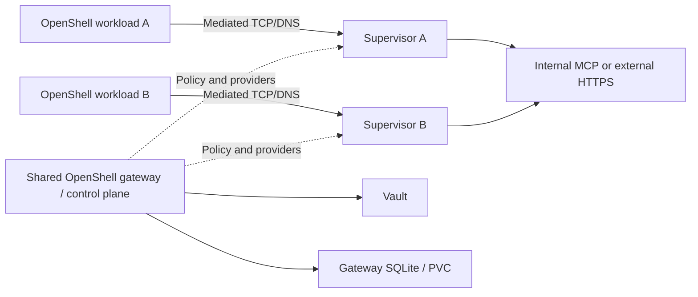

# OpenShell pilot compared with agent-auth

This branch pilots NVIDIA OpenShell **0.1.5** alongside the existing kagent **1.0.0-alpha17** / Substrate **0.6.0-alpha3** demo. OpenShell runs in a separate Minikube profile, `openshell-pilot`, with Calico. The original `auth-demo` profile, shared Envoy path, default Agent/Harness, and user kubeconfig are preserved. A temporary Agent/Harness is created and deleted for the native lifecycle test.

OpenShell covers much of the sandbox enforcement and provider functionality, but adopting it does not automatically supply our kagent Session integration, ServiceAccount permission source, or shared egress topology. The pilot exercises native OpenShell capabilities without adding those integrations or modifying upstream runtime source.

## Reproduce

First provision the ordinary demo with `python3 scripts/up.py`; the pilot reuses its locally built Mastra/test-API images, synthetic fixture keys, and demo CA. Then run these commands from the repository root, sequentially:

```bash
python3 pilots/openshell/bootstrap.py
python3 pilots/openshell/test_functional.py
python3 pilots/openshell/test_credentials.py
python3 pilots/openshell/test_lifecycle.py
python3 pilots/openshell/benchmark.py
python3 pilots/openshell/summarize.py
```

The bootstrap pins the CLI release and SHA-256, Helm chart version, Kubernetes 1.37, and Agent Sandbox controller v1.0.8. Its gateway configuration selects **push** delivery; polling is OpenShell's default. Python requirements are the repository's existing requirements. Linux must support the Landlock and seccomp mechanisms required by OpenShell; the pilot uses `landlock.compatibility: hard_requirement`.

All pilot Kubernetes operations use `.cache/openshell-kubeconfig` and explicit context `openshell-pilot`. CLI credentials, gateway registration, Vault initialization material, and downloads remain under ignored `.cache/openshell-pilot`; private files use mode 0600. Tests manage their own local port forwards. Setup reuses the original demo's local Vault only to read synthetic test values; it creates a separate pilot Vault/PVC and does not change the original credentials.

`Dockerfile` adds a sandbox account and an optional state probe to the same Node 22.22.1 / Mastra / curl image used by our command Pod. The benchmark does not enable the probe. `Dockerfile.supervisor` retains the pinned upstream supervisor binary and adds only our public demo CA to the system trust bundle. The Kubernetes driver in this release rejects `proxy_ca_bundle` without an actual corporate proxy, and does not expose the independent `additional_ca_bundle` option available in the supervisor binary. TLS verification remains enabled.

The gateway uses the chart's default SQLite/PVC backend. Provider credentials use its built-in Vault KV v2 driver with Kubernetes authentication and a role confined to OpenShell-managed provider storage. The authentication mocks hold private expected synthetic values to verify exact credential acceptance; the internal mock's expected values are mounted as fixture-only Kubernetes Secret data. Workloads receive only opaque placeholders, and no provider credential values appear in reports.

## Request and permission paths



Each Kubernetes sandbox has a separate workload Pod and supervisor Pod. The shared OpenShell gateway is the control plane; ordinary outbound API traffic is opened by that sandbox's supervisor. NetworkPolicy prevents workload connections from bypassing mediation. The test independently starts a process outside OpenShell's child syscall filter and confirms that the outer network fence still blocks direct access. An unrelated Pod in the same namespace retains direct access.

Our native path remains `sandbox → worker atunnel → shared Envoy → destination`; the enrolled Pod uses its relay to that same Envoy. Native kagent's `EgressPolicy` CRD supplies the origin allowlist, which kagent compiles into Substrate Actor policy. Envoy delegates native admission to the unchanged Substrate processor. Our separate ext_proc then checks the caller's watched ServiceAccount permissions and obtains the exact Vault grant. This does not generate a static Envoy route for every permission.

In OpenShell, `policy.py` supplies native endpoint/binary/HTTP rules through the OpenShell policy API. The two provider profiles are endpointless, so attaching them does not independently add destination grants. Each allowed endpoint explicitly names its provider through `credential_binding`. This lets the test remove a network permission while keeping the same sandbox and provider attachments.

| Requirement | Our implementation | OpenShell pilot / remaining integration |
| --- | --- | --- |
| Existing native kagent Sessions | Supported without upstream source changes | Not integrated; OpenShell is running its own sandboxes |
| Ordinary enrolled Pods | Existing Pod template, capture, relay, UID binding | Workload must run under OpenShell's managed runtime; arbitrary existing Pod adoption was not implemented |
| Destination/method/path permissions | Complete additive ServiceAccount grants | Native rules; all four subsets of two grants tested |
| Authoritative ServiceAccount UID and label watches | Bridge and Kubernetes informers | An adapter/controller is still required; the pilot uses explicit OpenShell API policies |
| Shared egress deployment for both caller types | One inspecting Envoy deployment | Supervisor per sandbox; shared gateway is the control plane |
| Static credentials from Vault | Read existing KV paths with a read-only role | Built-in driver stores/reads/deletes its own provider KV records; existing arbitrary KV paths need adaptation |
| Credential refresh | Explicit control-plane cache invalidation | Provider API update/push tested with stable placeholders and no workload restart |
| Arbitrary Authorization value | Our processor replaces it after authorization | Unknown literal is forwarded and receives upstream 401; recognized placeholders are substituted |
| Cross-origin credential misuse | Gateway selects the grant's key | Wrong-origin recognized placeholder is rejected before upstream |
| MCP tool names | Current demo only filters HTTP endpoint/method/path | Built-in MCP request method/tool rules tested against the authentication mock |
| Arbitrary Go filtering | Our executable policy evaluator | External supervisor middleware is documented; our Envoy ext_proc service was not ported to its different RPC contract |

The MCP check uses valid JSON-RPC request payloads: `read_status` reaches the authentication mock and `delete_resource` is blocked. It is request-policy evidence, not a complete MCP protocol client/server integration. Middleware, PostgreSQL/HA, and a custom kagent compute/isolation adapter were not deployed or benchmarked. Direct out-of-band Vault rotation was not tested; the verified rotation uses OpenShell's provider API.

## Functional evidence

- [35 OpenShell checks](../../artifacts/openshell-functional-results.json): Mastra Node HTTP and real curl commands, both destination locations, additive grant subsets, runtime updates, forbidden operations, forged credentials, cross-destination credential misuse, enforced network fencing, unrelated Pod access, MCP request filtering, and public Internet HTTPS.
- [8 credential checks](../../artifacts/openshell-credential-results.json): workload placeholders rather than real keys, zero Vault reads across 50 warm requests, wrong-value rotation producing actual upstream 401, restoration to 200 using the same placeholder, unchanged process/RAM marker, and denial outside the gateway's Vault role.
- [59 fresh checks of our existing gateway](../../artifacts/openshell-baseline-shared-gateway-results.json): the original full caller/grant matrix, concurrent identities, TLS trust boundaries, credential injection, and internal/external paths continue to pass after the pilot was installed.
- [Lifecycle comparison](../../artifacts/openshell-lifecycle-comparison.json): actual process and persistent/temporary file probes through both native lifecycle APIs.

## Performance

[Raw performance report](../../artifacts/openshell-performance-comparison.json), [derived summary](../../artifacts/openshell-comparison-summary.json).

All **136,107 requests across 60 timed stages succeeded**, with zero transport errors or wrong credentials, exact upstream audit deltas, no request-limit truncation, and successful recovery calls. The run took 467.9 seconds including preparation, warm-up, A2A/CLI management, auditing, and cleanup.

The same Mastra tool and test-API binary ran on both systems. Stages use closed-loop concurrency 1, 8, and 32 for six seconds, twice; the second repetition reverses caller order. Every application container and the OpenShell supervisor has a one-CPU limit. Both Minikube profiles request eight CPUs and 16 GiB on the same host. Inspection of the Docker node containers found the 16-GiB memory limits but **no node-level CPU quotas**; the nodes share the host's CPUs, while Kubernetes workload CPU limits apply. No other integration suites ran during these timed stages. [Installation metadata](../../artifacts/openshell-installation.json) records these actual limits and confirms identical upstream/pilot supervisor executable hashes.

Below, request rates combine completed requests divided by combined tool execution time across the two repetitions, at **concurrency 8**. The latency range contains the two measured p95 values; percentiles are not averaged or treated as a pooled percentile. Request latency excludes invocation setup; that wall time is recorded separately.

<!-- comparison-table:start -->

| Workload | Target | Our enrolled Pod, req/s | Our kagent, req/s | OpenShell, req/s | OpenShell p95 range |
| --- | --- | ---: | ---: | ---: | ---: |
| fetch | mcp | 375.85 | 382.18 | 1324.80 | 15.29–18.13 ms |
| fetch | external | 346.92 | 348.78 | 1542.59 | 11.09–11.77 ms |
| curl | mcp | 81.58 | — | 49.00 | 213.26–226.52 ms |
| curl | external | 61.36 | — | 14.48 | 694.78–695.10 ms |

<!-- comparison-table:end -->

OpenShell's fetch path was substantially faster in these runs. Our command path was faster for repeated curl invocations, especially outside-cluster HTTPS. At concurrency 32, external curl p95 was **3.47–3.51 seconds** with OpenShell versus **0.914–0.917 seconds** with our enrolled Pod. Fetch reuses connections, while every curl invocation starts a new process and connection. The performance difference was repeated; its internal cause was not profiled, and this pilot makes no claim about a single underlying bottleneck.

These are deployed-system comparisons, not isolated proxy benchmarks. The original path includes a shared Envoy, native authorization helper, our ext_proc, control plane and PostgreSQL; OpenShell uses local supervisor enforcement and credential resolution. The native kagent run uses gVisor, while the OpenShell workload uses its Landlock/seccomp runtime. CNI, control-plane storage, runtime isolation and component budgets differ. No comparison establishes equivalent security boundaries, production capacity, or overnight stability.

Our warm measured interval recorded zero ServiceAccount/Pod/native Session GETs, zero Kubernetes LISTs, and zero Vault reads/logins. OpenShell's separate 50-request check recorded zero Vault credential reads; we did not instrument all of its Kubernetes API traffic. Five-second resource samples are retained in the raw report and can miss instantaneous peaks.

## Pause, suspend, memory and disk

The test puts a random marker only in process memory, another in persistent storage, and another under `/tmp`. It reads them before and after lifecycle operations. It also confirms that native kagent's immutable authorization binding still allows the same Session after resume.

| Tested operation | RAM marker | Persistent directory | `/tmp` marker | Identity |
| --- | --- | --- | --- | --- |
| Manual `SIGSTOP` / `SIGCONT` of the OpenShell application | Preserved; RAM stays allocated | Preserved | Preserved | Same sandbox/process |
| OpenShell Kubernetes stop/start | New process / RAM lost | `/sandbox` preserved on the PVC | Lost | Same sandbox ID; new runtime generation |
| Native kagent Session suspend/resume | New process / RAM lost | `/data` preserved through volume snapshots | Lost | Same Session ID; authorization binding remains valid |

The manual signal test is a process-freeze diagnostic, not an OpenShell pause API or a durable checkpoint. OpenShell's tested Kubernetes stop/start stops compute and restarts its canonical command; retained workspace files do not imply retained process memory or an entire writable root filesystem snapshot.

The pinned kagent Session workflow explicitly requests and accepts **`SNAPSHOT_FIDELITY_VOLUMES`**. It also quiesces settled/idle Sessions to that fidelity. Thus a native suspend call may find that the Session is already quiescent; the native API timings in the report must not be compared directly with OpenShell CLI/pod lifecycle wall times. The test confirms process memory is not restored. Lower-level Substrate fidelity enums or another OpenShell backend must not be interpreted as RAM-checkpoint support in these tested Session/Kubernetes paths.

The bridge was not extended with public lifecycle endpoints. An administrative test Pod calls kagent's existing `SuspendSession` and `ResumeSession` RPCs; the separate test Agent/Harness is removed afterward.

Neither tested path provides a durable RAM checkpoint that frees memory and later resumes execution at the same instruction. That requirement remains additional work. Persistent application state must be written under the retained directory; both tested operations keep the same logical identity.

Conversation/task history is separate from process RAM. Our kagent path uses its A2A/TaskStore and PostgreSQL persistence. OpenShell workspace retention can preserve files an agent writes, but it does not itself implement that kagent Session/TaskStore contract. The state probes establish RAM and file behavior, not automatic semantic recovery of an arbitrary agent conversation.

## Assessment and operation

For a platform that can launch workloads as OpenShell sandboxes, its native policy and provider implementation is a credible replacement for substantial custom enforcement machinery. It also offers built-in MCP request filtering. Keeping our existing kagent Sessions, ServiceAccount UID permissions, existing Vault paths, and one shared gateway still requires integration work; replacing the shared Envoy deployment with OpenShell alone does not implement those contracts.

No runtime source was patched in this pilot. The CA-only supervisor image and state-probe application image are explicit in this directory. The existing demo remains deployed. The pilot leaves `mastra-pilot` available for review; benchmark sandboxes, unrelated probe Pods, temporary native Sessions, helper Pods and the native lifecycle Agent/Harness are removed.

To stop only the pilot cluster after review:

```bash
.cache/bin/minikube stop -p openshell-pilot
```

That retains its local cluster disks, including the OpenShell workspace and Vault PVCs. Deleting the profile removes that local test infrastructure. The separate `auth-demo` profile is unaffected.

Primary references: [OpenShell architecture](https://docs.nvidia.com/openshell/latest/about/architecture), [Kubernetes requirements](https://docs.nvidia.com/openshell/latest/kubernetes/setup), [network/MCP rules](https://docs.nvidia.com/openshell/latest/how-it-works/policies/network-rules), [provider profiles](https://docs.nvidia.com/openshell/latest/how-it-works/providers/profiles), [Vault configuration](https://docs.nvidia.com/openshell/latest/how-it-works/gateways/configuration#credential-drivers), [stop/start semantics](https://docs.nvidia.com/openshell/latest/how-it-works/sandboxes/overview#stop-and-start-sandboxes), and [pinned kagent Actor template](https://github.com/kagent-dev/kagent/blob/8392184232e9/go/core/internal/substrate/actor_template.go).
